

  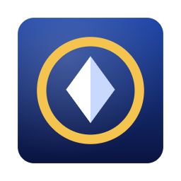

<h1 align="center">Kdo chce bít milionáře</h1>

  <b>Play the Czech quiz-and-punch parody Kdo chce bít milionáře natively on a modern Mac or Windows PC, with optional AI-upscaled art.</b> 
  Free and open source. Bring your own original CD.

  <a href="https://github.com/007hacky007/kdo-chce-bit-milionare/releases/latest"><b>Download the latest version</b></a>
  &nbsp;·&nbsp;
  <a href="#getting-started">Getting started</a>
  &nbsp;·&nbsp;
  <a href="#what-you-need">What you need</a>
  &nbsp;·&nbsp;
  <a href="#questions">Questions</a>
  &nbsp;·&nbsp;
  <a href="#česky">Česky</a>

  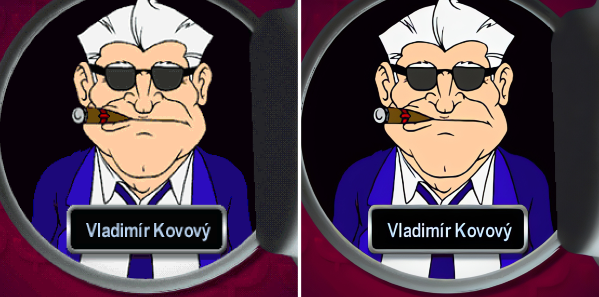
   Same screen, same moment. Original art on the left, enhanced (upscaled 3x) on the right.

> [!IMPORTANT]
> The game itself is not included. You need your own original CD of
> "Kdo chce bít milionáře" (the Czech TopCD release), or a disc image (`.iso`) you
> made of it. The game copies its data from it once, on your computer.

## What it is

"Kdo chce bít milionáře" is the Czech release of the 2000 Windows game
"Who Wants to Beat Up a Millionaire": answer quiz questions, and when you get one
right, you get to punch the millionaire. This project is a new engine that runs the
original game natively on Macs with Apple silicon and on Windows 10 and 11, without an
emulator:

- **The whole game**: questions and lifelines, the money ladder, the beat-up rounds,
  videos, voice lines and endings. Question selection, shuffling, lifeline odds and
  timing follow the original.
- **Hotseat for 1 to 4 players** on one keyboard, as in the original.
- **Enhanced graphics**, if you want them: every picture and video frame enlarged three
  times by an AI upscaler (Real-ESRGAN), made once on your own computer. Nothing is
  downloaded.
- **Press F8** at any time to switch between the original and the enhanced graphics.
  Only the pictures change; your game goes on.
- **F10** opens the options over the paused game: graphics, scaling (fit, whole
  multiples, stretch), fullscreen, volume, importing the data again and making the
  enhanced graphics again.
- **F11** (or Alt+Enter, or Control+Command+F on a Mac) switches fullscreen. The window
  remembers its size.
- Bugs of the original that crash, lock up or show garbage are fixed. Everything else,
  keys and mouse included, works as it did in 2000.

| A question | A beat-up round |
| --- | --- |
| 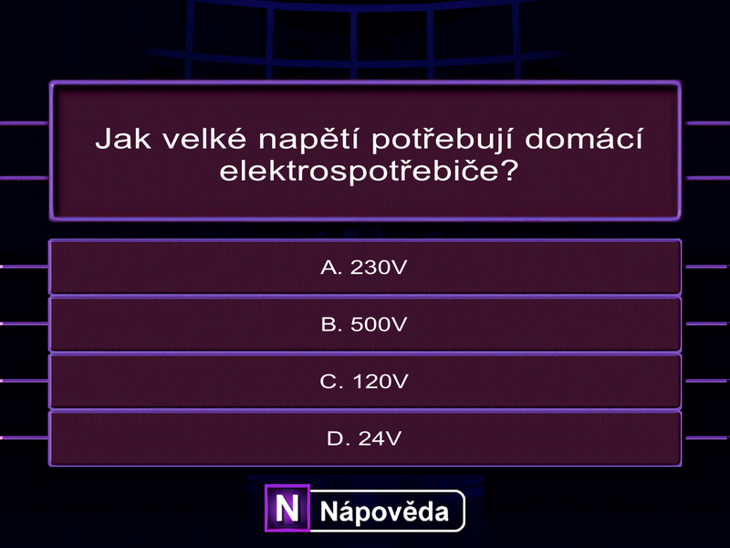 | 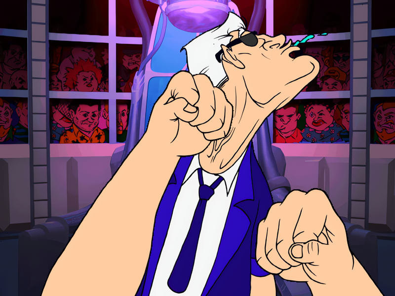 |
| **The intro before the first question** | **Play again?** |
| 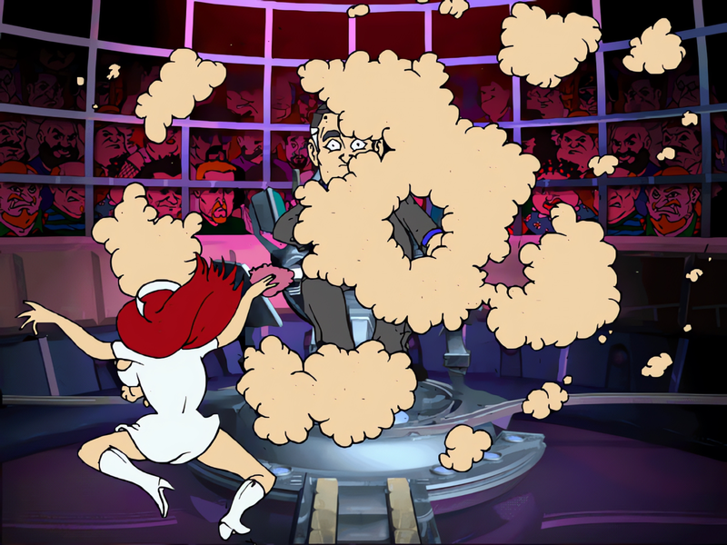 | 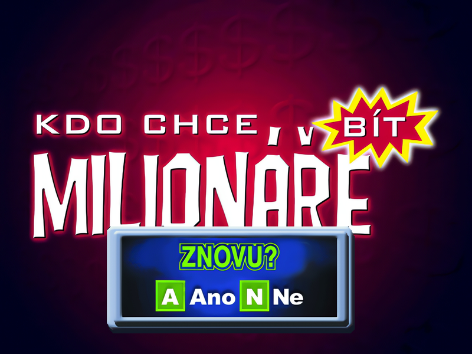 |

Press **F10** for the options:

  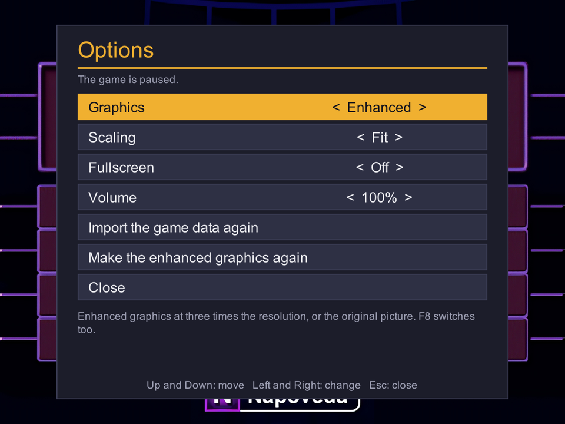

## Getting started

1. **Download the game** for your computer from the
   [latest release](https://github.com/007hacky007/kdo-chce-bit-milionare/releases/latest):
   - Mac: `Milionar-<version>-macos-arm64.dmg`
   - Windows: `Milionar-<version>-windows-x64-setup.exe`

   Each file has a `.sha256` checksum next to it.
2. **Install it.**
   - **Mac:** open the disk image and drag *Milionar* onto *Applications*. The app is not
     signed by Apple, so macOS refuses to open it the first time. In Finder, right-click
     (or Control-click) the app, choose *Open*, then *Open* again. On macOS 15 and later
     that may not be enough: try to start the app, then open *System Settings > Privacy &
     Security*, scroll down and click *Open Anyway* next to the message about Milionar.
   - **Windows:** run the installer. If SmartScreen says "Windows protected your PC",
     click *More info* and then *Run anyway*. By default the game installs for you only,
     without administrator rights; the installer speaks Czech and English.
3. **Start the game and choose your CD.** A setup wizard opens on the first start. Pick
   the inserted CD, a disc image (`.iso`), the `Setup.exe` from the CD or a folder where
   you installed the game before. You can also drag the file or folder onto the window.
4. **Let it import.** The game checks every file against the TopCD release and copies
   about 350 MB. After that you no longer need the CD.
5. **Make the enhanced graphics, or skip them.** This takes about 8 minutes on a Mac
   with Apple silicon, longer on other computers. You can cancel at any time and
   continue later from the options (F10).
6. **Play.** Playing needs no internet connection.

<table>
  <tr>
    <td width="50%" valign="top">
      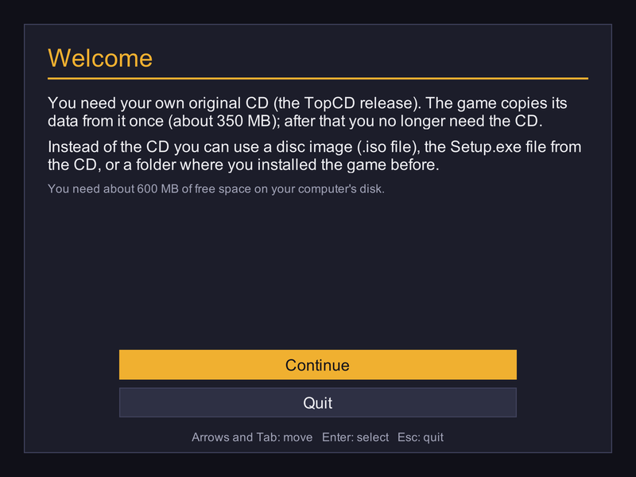 
      <b>Welcome.</b> The wizard says what it needs before it starts.
    </td>
    <td width="50%" valign="top">
      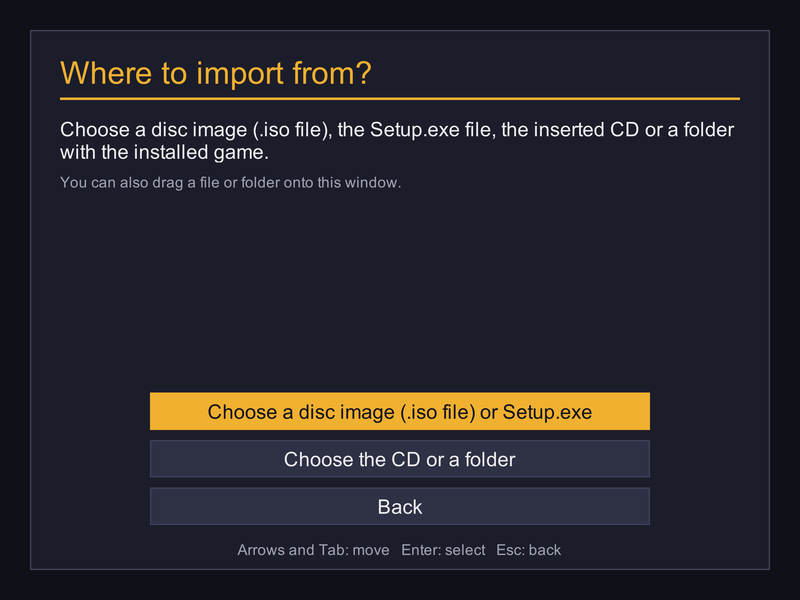 
      <b>Choose your CD.</b> A disc image, <code>Setup.exe</code>, the CD itself or
      a folder. Your original stays untouched.
    </td>
  </tr>
  <tr>
    <td width="50%" valign="top">
      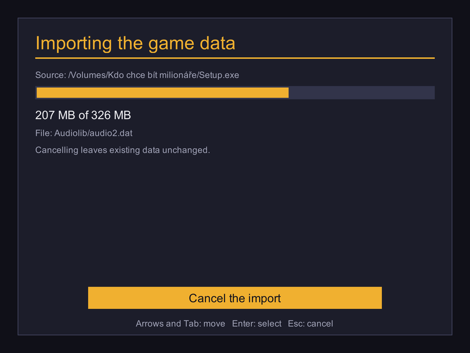 
      <b>Importing.</b> Every file is checked as it is copied. Cancelling leaves
      earlier data unchanged.
    </td>
    <td width="50%" valign="top">
      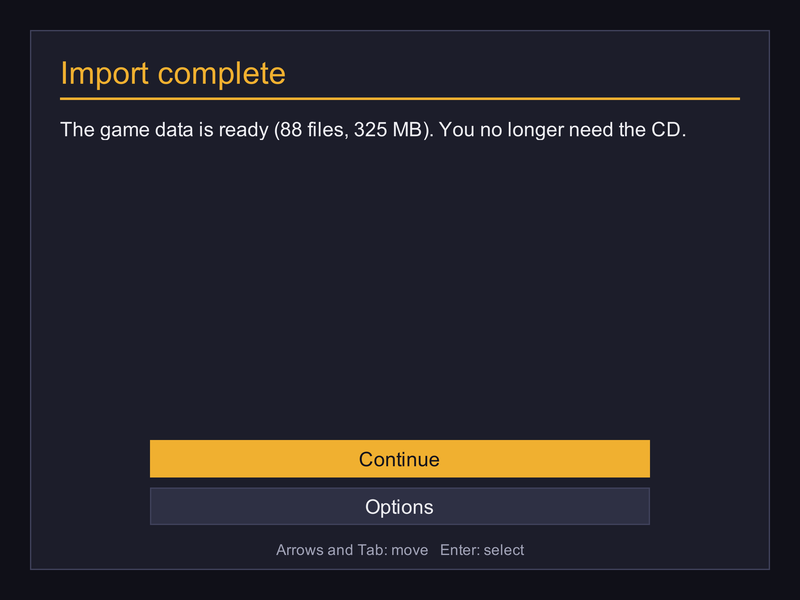 
      <b>Done.</b> The game data is ready and the CD can go back on the shelf.
    </td>
  </tr>
  <tr>
    <td width="50%" valign="top">
      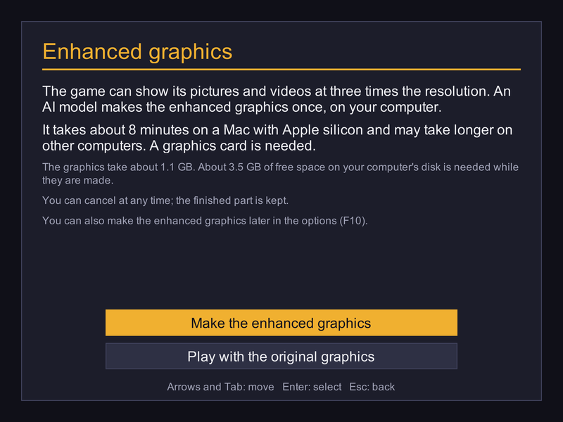 
      <b>Enhanced graphics?</b> Make them now, or play with the original graphics
      and decide later.
    </td>
    <td width="50%" valign="top">
      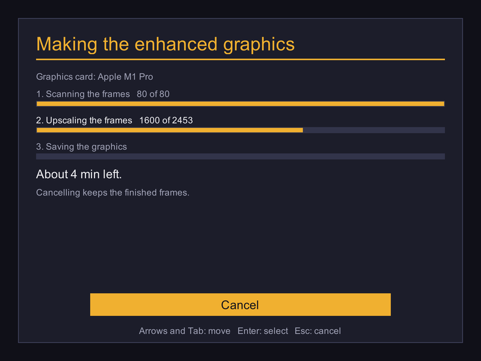 
      <b>Upscaling.</b> Frame by frame, on your graphics card. The finished part is
      kept if you cancel.
    </td>
  </tr>
  <tr>
    <td width="50%" valign="top">
      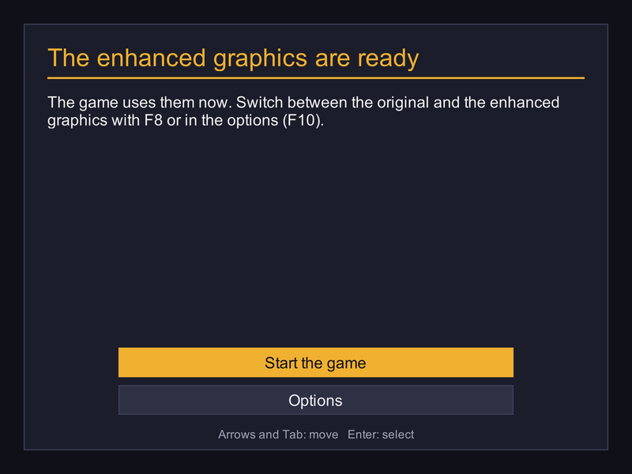 
      <b>Ready.</b> The game uses the enhanced graphics from now on. F8 switches back.
    </td>
    <td width="50%" valign="top">
      <b>Something went wrong?</b> The game writes a log, <code>milionar.log</code>,
      into its data folder (see <a href="#questions">Questions</a>). Attach it to a new
      <a href="https://github.com/007hacky007/kdo-chce-bit-milionare/issues">issue</a>.
    </td>
  </tr>
</table>

The wizard and the options follow your system language: Czech on a Czech or Slovak
system, English otherwise.
The game itself is in Czech, like the original.

The full player guide, in Czech and English, with every step, the keys, uninstalling
and troubleshooting: [docs/install.md](docs/install.md).

## What you need

| | Mac | Windows |
| --- | --- | --- |
| System | macOS 11 Big Sur or newer, Apple silicon (M1 or later). Intel Macs are not supported. | Windows 10 or 11, 64-bit (x64) |
| Graphics for the enhanced art | Built in, nothing to install | A graphics card with Vulkan support and a current driver |
| Free disk space | About 600 MB for the game data; for the enhanced art about 1.1 GB more, and about 3.5 GB free while it is made | Same |
| Time for the enhanced art | About 8 minutes | Depends on the graphics card |
| Internet | Not needed | Not needed |

**Your CD.** Only the Czech TopCD release of the game is supported. The import
recognises it by its files and checks each one.

The enhanced graphics are optional. Without a graphics card the game runs with the
original graphics.

> [!NOTE]
> The Windows version has been tested in a Windows 11 virtual machine: installing, the
> import, a full game, the options and uninstalling. The enhanced graphics were checked
> there only with a software graphics driver, not yet on a real graphics card. Please
> report what you find.

## Questions

**Is the game included?** No. Nothing from the original game is in the downloads or in
this repository. The game reads it from your CD, on your computer.

**Do I need the CD to play?** Only once, for the import. After that the game runs from
its own copy of the data.

**Can I switch back to the original look?** Yes, press **F8** while playing, or change
*Graphics* in the options (**F10**).

**Where are the game data, settings and log?** On a Mac in
`~/Library/Application Support/milionar-port/Milionar`, on Windows in
`%APPDATA%\milionar-port\Milionar`. The folder holds the imported data (`game/`), the
enhanced graphics (`upscaled/frames.upk`), the options (`settings.json`) and the log
(`milionar.log`). In Finder use *Go > Go to Folder* (Shift+Command+G); on Windows type
`%APPDATA%\milionar-port` into the File Explorer address bar.

**I cancelled the enhanced graphics. Is the work lost?** No. The finished frames stay in
`upscaled/cache/` in the data folder, and the next run continues from them. If you do
not want to finish and need the space, quit the game and delete that folder.

**It says I need a graphics card with Vulkan support.** Update the graphics driver from
the card maker's website (NVIDIA, AMD, Intel). The game keeps running with the original
graphics meanwhile.

**macOS says the app is damaged or cannot be verified.** It is not signed by Apple.
Follow step 2 above, or remove the quarantine flag in Terminal:
`xattr -d com.apple.quarantine /Applications/Milionar.app`

**The import says a file does not match the release.** Only the TopCD release is
supported. The CD may be damaged; try making an image of it or using another drive.

**Does removing the game remove my data?** On a Mac, no: delete
`~/Library/Application Support/milionar-port` yourself if you want it gone. On Windows
the uninstaller asks whether to keep the imported data and the enhanced graphics.

**Gamepad?** Not supported. Keyboard and mouse, as in the original.

## Česky

Kdo chce bít milionáře je tu jako nová nativní verze pro Macy s čipem Apple (macOS 11
a novější) a pro 64bitová Windows 10 a 11. Hra sama v balíčku není: potřebujete vlastní
originální CD (vydání TopCD) nebo jeho obraz. Stáhněte si instalační balíček z
[poslední verze](https://github.com/007hacky007/kdo-chce-bit-milionare/releases/latest)
a při prvním spuštění vyberte v průvodci CD, obraz `.iso`, `Setup.exe` z CD nebo složku
s nainstalovanou hrou. Hra si data jednou zkopíruje a potom už CD nepotřebuje. Volitelně
pak vytvoří vylepšenou grafiku v trojnásobném rozlišení (na Macu s čipem Apple asi
8 minut). Klávesa **F8** přepíná původní a vylepšenou grafiku, **F10** otevře nastavení,
**F11** nebo **Alt+Enter** přepne celou obrazovku. Na Macu aplikaci poprvé otevřete
přes pravé tlačítko > *Otevřít* (na macOS 15 a novějším přes *Nastavení systému >
Soukromí a zabezpečení > Přesto otevřít*), ve Windows přes *Další informace > Přesto
spustit*. Verze pro Windows je vyzkoušená ve virtuálním počítači s Windows 11, vylepšená
grafika zatím jen se softwarovým ovladačem, ne se skutečnou grafickou kartou.
Podrobný návod v češtině: [docs/install.md](docs/install.md#česky).

## For developers

How to build from source, the command-line tool that imports, checks and upscales the
data, and the tests: [docs/DEVELOPERS.md](docs/DEVELOPERS.md). Building the release
packages: [docs/build.md](docs/build.md) and [packaging/README.md](packaging/README.md).
What is in each version: [RELEASE-NOTES.md](RELEASE-NOTES.md).

## License

The engine is free software under the GPLv3 (GPL-3.0-only), see [LICENSE](LICENSE).
Third-party components keep their own licenses, see
[THIRD_PARTY_NOTICES.md](THIRD_PARTY_NOTICES.md).

"Kdo chce bít milionáře", "Who Wants to Beat Up a Millionaire" and their original files
belong to their respective rights holders and are not part of this project.
